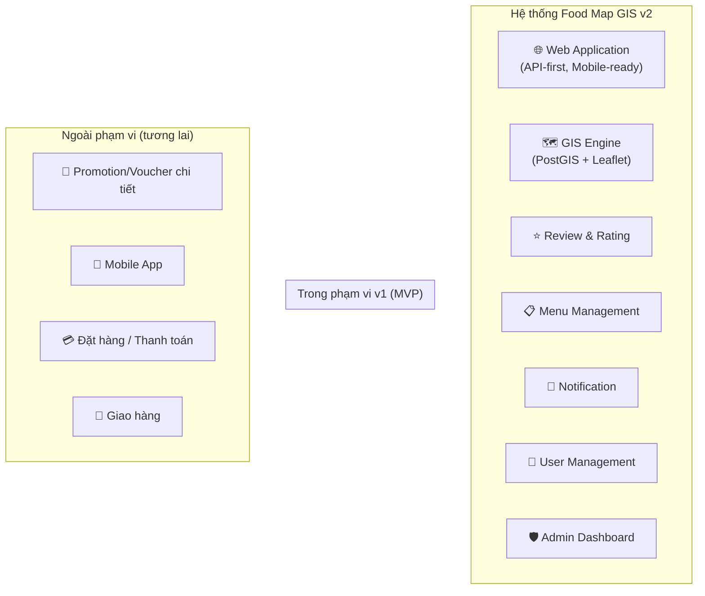
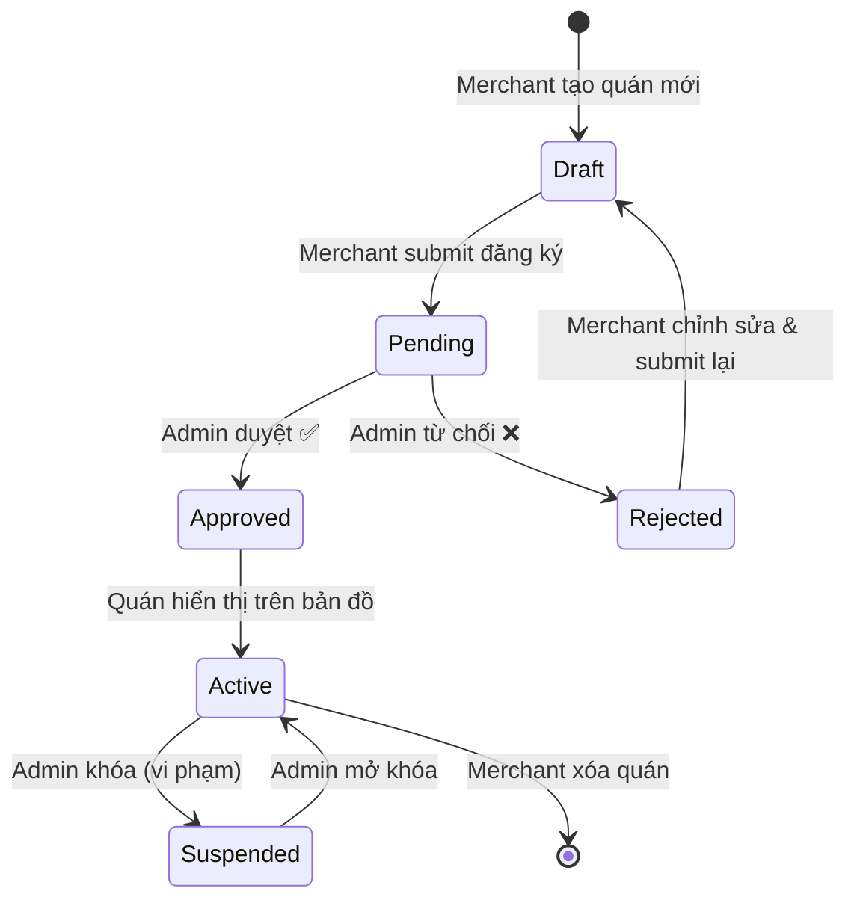
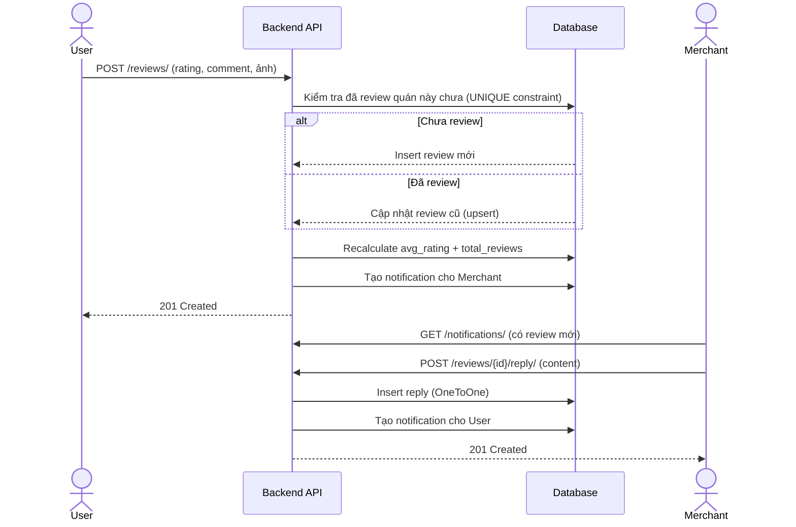
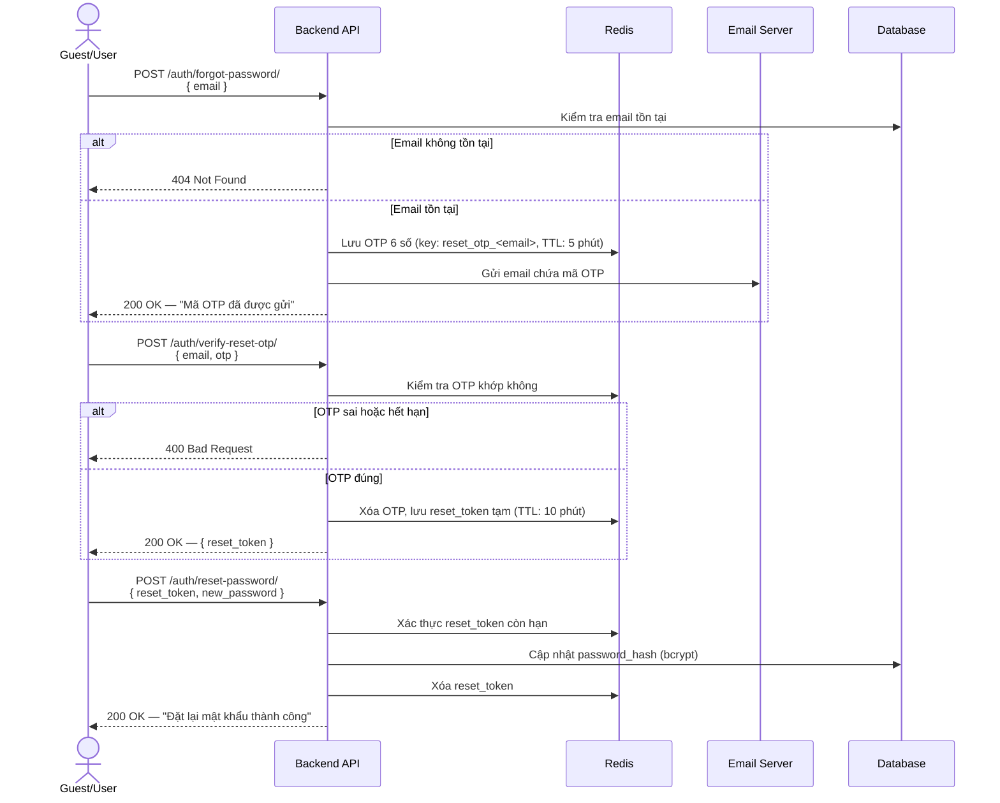

# 📋 Tài liệu Đặc tả Yêu cầu Phần mềm (SRS)
## Hệ thống WebGIS — Bản đồ Ẩm thực Việt Nam (Food Map GIS v2)

| Thông tin | Chi tiết |
|---|---|
| **Phiên bản** | 1.1 — Updated |
| **Ngày tạo** | 16/09/2026 |
| **Ngày cập nhật** | 25/09/2026 |
| **Phương pháp** | Phỏng vấn BA 4 giai đoạn |
| **Trạng thái** | ✅ Đã xác nhận — Sẵn sàng triển khai |

---

## 1. Tổng quan dự án

### 1.1 Mục tiêu
Xây dựng hệ thống **WebGIS bản đồ ẩm thực** cho phép:
- **Người dùng (User)** tìm kiếm, khám phá và đánh giá quán ăn trên bản đồ tương tác trên phạm vi **toàn quốc Việt Nam**.
- **Chủ quán (Merchant)** đăng ký, quảng bá quán ăn, quản lý thực đơn và tương tác với khách hàng.
- **Quản trị viên (Admin)** kiểm soát nội dung, duyệt quán ăn mới và quản lý toàn bộ hệ thống.

Dự án phục vụ **2 mục đích song song**:
1. Đồ án / Thực tập tốt nghiệp — thể hiện năng lực xây dựng hệ thống WebGIS bài bản.
2. Portfolio xin việc — sử dụng **ASP.NET Core + Clean Architecture** để tạo lợi thế cạnh tranh trên thị trường .NET.

### 1.2 Phạm vi hệ thống



### 1.3 Nền tảng & Triển khai

| Hạng mục | Quyết định |
|---|---|
| **Nền tảng** | Web (responsive), API thiết kế sẵn sàng cho Mobile |
| **Backend** | ASP.NET Core (C#) + Clean Architecture |
| **Database** | PostgreSQL + PostGIS |
| **Cache** | Redis |
| **Bản đồ** | Leaflet.js + OpenStreetMap + GeoServer WMS |
| **Frontend** | Không ưu tiên (tập trung Backend + API) |
| **Admin Dashboard** | Giao diện web (Razor Pages / Blazor Server) |
| **Deployment** | Docker → Railway / Render / Fly.io (miễn phí) |
| **Quy mô** | Thiết kế để scale, không giới hạn số lượng quán |

---

## 2. Đối tượng sử dụng (Actors)

### 2.1 Danh sách Actor

| Actor | Mô tả | Xác thực |
|---|---|---|
| **Guest** (Khách vãng lai) | Người truy cập chưa đăng nhập | Không cần |
| **User** (Khách hàng) | Người dùng đã đăng ký, tìm quán và viết review | JWT |
| **Merchant** (Chủ quán) | Người đăng ký quán ăn, quản lý thông tin và phản hồi review | JWT + Role `merchant` |
| **Admin** (Quản trị viên) | Quản lý toàn bộ hệ thống, duyệt quán, quản lý user | JWT + Role `admin` |

### 2.2 Ma trận phân quyền

| Chức năng | Guest | User | Merchant | Admin |
|---|:---:|:---:|:---:|:---:|
| Xem bản đồ quán ăn (public) | ✅ | ✅ | ✅ | ✅ |
| Xem chi tiết quán ăn | ✅ | ✅ | ✅ | ✅ |
| Tìm kiếm / Lọc quán ăn | ✅ | ✅ | ✅ | ✅ |
| Viết review / Chấm sao | ❌ | ✅ | ❌ | ❌ |
| Like/Dislike review | ❌ | ✅ | ✅ | ✅ |
| Bookmark quán ăn | ❌ | ✅ | ✅ | ❌ |
| Đăng ký quán ăn mới | ❌ | ❌ | ✅ | ❌ (chỉ duyệt) |
| Quản lý quán của mình (CRUD) | ❌ | ❌ | ✅ (quán sở hữu) | ❌ |
| Quản lý thực đơn (menu) | ❌ | ❌ | ✅ (quán sở hữu) | ❌ |
| Reply review khách hàng | ❌ | ❌ | ✅ (quán sở hữu) | ❌ |
| Xem thống kê quán | ❌ | ❌ | ✅ (quán sở hữu) | ✅ (toàn sàn) |
| Duyệt quán ăn mới (Approve / Reject) | ❌ | ❌ | ❌ | ✅ |
| Khóa / Mở khóa quán vi phạm (Suspend / Unsuspend) | ❌ | ❌ | ❌ | ✅ |
| Xóa quán / review vi phạm quy định | ❌ | ❌ | ❌ | ✅ |
| CRUD danh mục món ăn | ❌ | ❌ | ❌ | ✅ |
| Quản lý user (khóa/mở tài khoản) | ❌ | ❌ | ❌ | ✅ |
| Dashboard thống kê hệ thống | ❌ | ❌ | ❌ | ✅ |

---

## 3. Yêu cầu chức năng (Functional Requirements)

### 3.1 Module: Xác thực & Quản lý tài khoản (Authentication)

| Mã | Yêu cầu | Actor | Ưu tiên |
|---|---|---|---|
| **FR-AUTH-01** | Đăng ký tài khoản bằng **Email đã xác thực + Username + Password**. Khi đăng ký, chọn vai trò: `user` hoặc `merchant`. | Guest | Must |
| **FR-AUTH-02** | Đăng nhập bằng Username + Password, trả về **JWT Access Token + Refresh Token**. | Guest | Must |
| **FR-AUTH-03** | Làm mới Access Token bằng Refresh Token khi token hết hạn. | User, Merchant | Must |
| **FR-AUTH-04** | Đăng xuất: Hủy phiên đăng nhập (revoke refresh token). | User, Merchant | Must |
| **FR-AUTH-05** | Xem và cập nhật thông tin cá nhân (email, ngày sinh, ảnh đại diện). | User, Merchant | Must |
| **FR-AUTH-06** | Gửi mã OTP qua email để xác thực email trước khi cho phép đăng ký tài khoản. OTP hết hạn sau 5 phút. | Guest | Must |
| **FR-AUTH-07** | Xác thực OTP đăng ký → Cấp mã xác minh tạm thời để hoàn tất tạo tài khoản. Mọi tài khoản trong CSDL mặc nhiên đều đã được xác thực email. | Guest | Must |
| **FR-AUTH-08** | **Quên mật khẩu**: User nhập email → Hệ thống gửi OTP 6 số về email (TTL 5 phút, lưu Redis/Cache) → User nhập OTP xác thực → Nhập mật khẩu mới → Hệ thống cập nhật mật khẩu (bcrypt hash). Luồng gồm 3 bước: `POST /auth/forgot-password/` → `POST /auth/verify-reset-otp/` → `POST /auth/reset-password/`. | Guest | Must |

---

### 3.2 Module: Quán ăn & Dữ liệu không gian (Food Place + GIS)

| Mã | Yêu cầu | Actor | Ưu tiên |
|---|---|---|---|
| **FR-FP-01** | Hiển thị tất cả quán ăn **đã được duyệt** trên bản đồ tương tác (Leaflet markers). Guest có thể xem không cần đăng nhập. | Guest, User | Must |
| **FR-FP-02** | Xem chi tiết quán ăn: tên, địa chỉ, danh mục, giờ mở/đóng cửa, khoảng giá, ảnh, điểm đánh giá trung bình, tổng số review. | Guest, User | Must |
| **FR-FP-03** | Merchant **đăng ký quán ăn mới** với thông tin đầy đủ. Tọa độ xác định bằng **click bản đồ HOẶC nhập địa chỉ geocode**. Quán ở trạng thái **Pending** sau khi đăng ký. Nếu bị Admin Reject, Merchant được **chỉnh sửa và submit lại** (không cần tạo mới). | Merchant | Must |
| **FR-FP-04** | Merchant cập nhật thông tin quán ăn của mình (chỉ quán mình sở hữu). | Merchant | Must |
| **FR-FP-05** | Merchant xóa quán ăn của mình. | Merchant | Must |
| **FR-FP-06** | Merchant **upload nhiều ảnh** cho quán ăn (lưu trên Cloud Storage). | Merchant | Must |
| **FR-FP-07** | Merchant có thể đăng ký và quản lý **nhiều quán ăn** cùng lúc. | Merchant | Must |
| **FR-FP-08** | Trích xuất danh sách quán ăn dưới định dạng chuẩn **GeoJSON FeatureCollection** để render lên bản đồ. | System | Must |
| **FR-FP-09** | Xếp hạng **Top N quán ăn** có điểm đánh giá cao nhất (có ≥1 review). | Guest, User | Should |
| **FR-FP-10** | Hiển thị **bản đồ nhiệt (heatmap)** mật độ quán ăn hoặc lượt đánh giá. | Guest, User | Should |
| **FR-FP-11** | **Dẫn đường** đến quán ăn: Mở Google Maps / OSRM với tọa độ đích. | User | Should |

---

### 3.3 Module: Tìm kiếm & Lọc không gian (Search & Filter)

| Mã | Yêu cầu | Actor | Ưu tiên |
|---|---|---|---|
| **FR-SEARCH-01** | Tìm kiếm quán ăn theo **tên quán** hoặc **địa chỉ** (full-text search). | Guest, User | Must |
| **FR-SEARCH-02** | Lọc quán ăn theo **danh mục** (Loại hình → Danh mục con). | Guest, User | Must |
| **FR-SEARCH-03** | Lọc quán ăn theo **khoảng giá** (dưới 50k, 50k-100k, trên 100k...). | Guest, User | Must |
| **FR-SEARCH-04** | Lọc quán ăn theo **điểm đánh giá** (4 sao trở lên, 3 sao trở lên...). | Guest, User | Should |
| **FR-SEARCH-05** | Tìm kiếm quán ăn trong **bán kính** (1km, 3km, 5km) xung quanh vị trí người dùng. Sử dụng hàm không gian PostGIS `ST_DWithin()`. | User | Must |
| **FR-SEARCH-06** | Lọc quán ăn theo **tỉnh/thành phố, quận/huyện**. | Guest, User | Should |
| **FR-SEARCH-07** | Tìm kiếm **địa điểm trên bản đồ** bằng Geocoding (Nominatim). | Guest, User | Should |

---

### 3.4 Module: Danh mục (Category)

| Mã | Yêu cầu | Actor | Ưu tiên |
|---|---|---|---|
| **FR-CAT-01** | Danh mục quán ăn là **danh sách phẳng 1 tầng** đại diện cho **tên món chủ lực** của quán (VD: Phở, Lẩu, Bún bò, Cơm tấm, Cà phê, Trà sữa...). Admin tạo sẵn bằng seed data. Merchant **bắt buộc chọn 1 danh mục** khi đăng ký quán. | System | Must |
| **FR-CAT-02** | Admin CRUD (tạo, sửa, xóa) danh mục món chủ lực. | Admin | Must |
| **FR-CAT-03** | Danh sách danh mục là **public** (không cần đăng nhập), hiển thị cho dropdown khi đăng ký quán và filter bar trên bản đồ. | Guest | Must |

---

### 3.5 Module: Đánh giá & Phản hồi (Review & Reply)

| Mã | Yêu cầu | Actor | Ưu tiên |
|---|---|---|---|
| **FR-REV-01** | User viết đánh giá cho quán ăn: **rating 1-5 sao** + bình luận (text). Mỗi User chỉ được **1 review / quán** (có thể sửa/xóa). | User | Must |
| **FR-REV-02** | User **đính kèm ảnh chụp món ăn** trong review (upload lên Cloud Storage). **Giới hạn tối đa 5 ảnh / review**. | User | Should |
| **FR-REV-03** | User sửa / xóa review của chính mình. | User | Must |
| **FR-REV-04** | Sau mỗi lần tạo/sửa/xóa review → Hệ thống **tự động tính lại** `avg_rating` và `total_reviews` của quán ăn. | System | Must |
| **FR-REV-05** | User **Like hoặc Dislike** review của người khác. Mỗi user chỉ tương tác 1 lần / review. | User | Should |
| **FR-REV-06** | Danh sách review hiển thị **mới nhất xếp trước** (ORDER BY created_at DESC). | System | Must |
| **FR-REV-07** | Merchant **phản hồi (reply)** review của khách hàng trong quán mình. Mỗi review chỉ có **1 reply** (OneToOne). | Merchant | Must |
| **FR-REV-08** | Merchant sửa / xóa reply của mình. | Merchant | Must |

---

### 3.6 Module: Thực đơn (Menu)

| Mã | Yêu cầu | Actor | Ưu tiên |
|---|---|---|---|
| **FR-MENU-01** | Merchant tạo / sửa / xóa **món ăn** trong thực đơn quán. Mỗi món gồm: tên, giá, ảnh (tùy chọn), nhóm (category). | Merchant | Must |
| **FR-MENU-02** | Thực đơn phân theo **nhóm**: Món chính, Món phụ, Đồ uống, Tráng miệng (hoặc Merchant tự đặt tên nhóm). | Merchant | Should |
| **FR-MENU-03** | User/Guest xem thực đơn của quán ăn (chỉ xem, **không đặt hàng**). | Guest, User | Must |

---

### 3.7 Module: Yêu thích / Bookmark

| Mã | Yêu cầu | Actor | Ưu tiên |
|---|---|---|---|
| **FR-BM-01** | User **lưu quán ăn** vào danh sách yêu thích cá nhân (bookmark). | User | Should |
| **FR-BM-02** | User xem danh sách quán đã bookmark. | User | Should |
| **FR-BM-03** | User bỏ bookmark quán ăn. | User | Should |

---

### 3.8 Module: Thông báo (Notification)

> **Cơ chế**: Dùng **Polling** — Frontend tự động gọi API `GET /notifications/unread-count` mỗi **30 giây** để kiểm tra thông báo mới. Đơn giản, không cần WebSocket.

| Mã | Yêu cầu | Actor | Ưu tiên |
|---|---|---|---|
| **FR-NOTI-01** | User nhận **thông báo in-app** khi chủ quán phản hồi review của mình. | User | Should |
| **FR-NOTI-02** | Merchant nhận **thông báo in-app** khi quán được Admin duyệt (Approved/Rejected). | Merchant | Should |
| **FR-NOTI-03** | Merchant nhận **thông báo in-app** khi có review mới cho quán của mình. | Merchant | Could |
| **FR-NOTI-04** | Hiển thị icon **đổ chuông** với badge số thông báo chưa đọc. Frontend polling `GET /notifications/unread-count` mỗi **30 giây**. | User, Merchant | Should |
| **FR-NOTI-05** | User/Merchant đánh dấu thông báo là **đã đọc** (đơn lẻ hoặc tất cả). | User, Merchant | Should |

---

### 3.9 Module: Quản trị hệ thống (Admin)

| Mã | Yêu cầu | Actor | Ưu tiên |
|---|---|---|---|
| **FR-ADMIN-01** | **Duyệt quán ăn mới**: Xem danh sách quán Pending → Approve (hiển thị) / Reject (kèm lý do). | Admin | Must |
| **FR-ADMIN-02** | Quản lý danh sách người dùng: Xem, khóa/mở tài khoản, thay đổi role. | Admin | Must |
| **FR-ADMIN-03** | CRUD danh mục món ăn (2 tầng: Loại hình + Danh mục con). | Admin | Must |
| **FR-ADMIN-04** | Khóa / Mở khóa (`Suspend` / `Active`) quán ăn vi phạm; Xóa quán ăn / review vi phạm quy định. | Admin | Must |
| **FR-ADMIN-05** | **Dashboard thống kê** xây bằng **giao diện web** (Razor Pages hoặc Blazor Server): Tổng số quán ăn, tổng user, tổng review, quán mới chờ duyệt, biểu đồ xu hướng. | Admin | Should |
| **FR-ADMIN-06** | Quản lý dữ liệu bản đồ / ranh giới hành chính (upload shapefile, cấu hình WMS layer). | Admin | Could |

---

## 4. Quy trình nghiệp vụ quan trọng

### 4.1 Luồng đăng ký quán ăn (có duyệt Admin)



| Trạng thái | Hiển thị trên bản đồ? | Merchant chỉnh sửa? |
|---|---|---|
| `Draft` | ❌ | ✅ |
| `Pending` | ❌ | ❌ (chờ duyệt) |
| `Approved` / `Active` | ✅ | ✅ |
| `Rejected` | ❌ | ✅ (sửa lại) |
| `Suspended` | ❌ | ❌ |

### 4.2 Luồng Review & Reply



---

## 5. Yêu cầu phi chức năng (Non-Functional Requirements)

| Mã | Yêu cầu | Chi tiết |
|---|---|---|
| **NFR-01** | **Hiệu năng** | API response time < 500ms cho các truy vấn thông thường. Truy vấn không gian (radius search) < 1s với chỉ mục GiST. |
| **NFR-02** | **Bảo mật** | JWT stateless, mã hóa password bằng bcrypt, CORS whitelist, input validation, SQL injection prevention (ORM parameterized query). |
| **NFR-03** | **Khả năng mở rộng** | Database hỗ trợ Spatial Index (GiST) cho truy vấn không gian. API thiết kế RESTful, pagination cho danh sách lớn. |
| **NFR-04** | **API Documentation** | Tự động sinh Swagger UI (`/swagger`) và ReDoc (`/redoc`) từ code. |
| **NFR-05** | **Containerization** | Đóng gói bằng Docker, triển khai bằng Docker Compose (backend + redis + postgres). |
| **NFR-06** | **Kiến trúc** | Clean Architecture 4 layer: Domain → Application → Infrastructure → API. Tuân thủ Dependency Rule (inner layers không phụ thuộc outer). |

---

## 6. Database Schema sơ bộ (ERD tổng quan)

```
┌────────────────┐
│     users       │       ┌──────────────────────────────┐
│────────────────│       │        food_places             │
│ id (PK)        │◄──┐   │──────────────────────────────│
│ username       │   │   │ id (PK)                       │
│ password_hash  │   │   │ name, address                 │
│ email          │   │   │ geom (Point, SRID=4326)       │ ← PostGIS
│ role (enum)    │   └───│ owner_id (FK → users)          │
│ avatar_url     │       │ category_id (FK)               │──► categories
│ is_active      │       │ status (enum: Pending/Active/  │
│ created_at     │       │   Rejected/Suspended)          │
│ last_login     │       │ phone, opening_time, closing   │
└──────┬─────────┘       │ min_price, max_price           │
       │                 │ avg_rating, total_reviews      │
       │                 │ description                    │
       │                 └──────────┬───────────────────┘
       │                            │
       │    ┌───────────────┐       │    ┌───────────────────┐
       │    │  categories    │       ├───►│ food_place_images  │
       │    │───────────────│       │    │───────────────────│
       │    │ id (PK)       │       │    │ id, food_place_id  │
       │    │ name          │       │    │ image_url          │
       │    │ (Phở, Lẩu,   │       │    └───────────────────┘
       │    │  Cà phê, ...) │       │
       │    └───────────────┘       │    ┌───────────────────┐
       │                            ├───►│   menu_items       │
       │                            │    │───────────────────│
       │                            │    │ id, food_place_id  │
       │                            │    │ name, price        │
       │                            │    │ image_url, group   │
       │                            │    └───────────────────┘
       │                            │
       │                            │
  ┌────▼──────────┐        ┌────────▼────────┐
  │  bookmarks    │        │    reviews       │
  │───────────────│        │─────────────────│
  │ id (PK)       │        │ id (PK)         │
  │ user_id FK    │        │ user_id FK      │
  │ food_place_id │        │ food_place_id FK│
  │ created_at    │        │ rating (1-5)    │
  │ UNIQUE(u,fp)  │        │ comment         │
  └───────────────┘        │ UNIQUE(u,fp)    │
                           └──────┬──────────┘
                                  │
                    ┌─────────────┼────────────────┐
                    │             │                 │
              ┌─────▼──────┐ ┌───▼──────────┐ ┌───▼──────────┐
              │review_images│ │review_replies │ │review_reacts │
              │────────────│ │──────────────│ │──────────────│
              │ id, rev_id │ │ id           │ │ id           │
              │ image_url  │ │ review_id FK │ │ review_id FK │
              └────────────┘ │ merchant_id  │ │ user_id FK   │
                             │ content      │ │ type (enum)  │
                             └──────────────┘ │ like/dislike │
                                              │ UNIQUE(u,r)  │
              ┌─────────────────┐             └──────────────┘
              │  notifications   │
              │─────────────────│
              │ id (PK)         │
              │ user_id FK      │
              │ type (enum)     │
              │ message         │
              │ is_read         │
              │ reference_id    │
              │ created_at      │
              └─────────────────┘
```

**Tổng: 11 bảng** (bỏ `sub_categories`, gộp vào `categories` phẳng)

---

## 7. Quyết định đã xác nhận

> [!NOTE]
> Tất cả câu hỏi mở đã được Stakeholder xác nhận ngày **25/09/2026**. SRS chuyển sang trạng thái **Sẵn sàng triển khai**.

| # | Câu hỏi | Quyết định |
|---|---|---|
| **Q1** | Merchant bị Reject → tạo mới hay sửa lại? | ✅ **Merchant được chỉnh sửa và submit lại** (không cần tạo mới). Trạng thái `Rejected` → `Draft` → `Pending`. |
| **Q2** | Notification: Polling hay WebSocket? | ✅ **Dùng Polling** — gọi API mỗi 30 giây. |
| **Q3** | Giới hạn ảnh trong review? | ✅ **Tối đa 5 ảnh / review**. |
| **Q4** | Admin Dashboard: Web UI hay API thuần? | ✅ **Giao diện web** (Razor Pages / Blazor Server). |
| **Q5** | Cần chức năng báo cáo review vi phạm? | ❌ **Không cần** — Admin tự phát hiện và xóa trực tiếp. |

---

## 8. Luồng Quên mật khẩu (FR-AUTH-08)



**3 endpoint mới cần triển khai:**

| Method | Endpoint | Mô tả | Auth |
|---|---|---|---|
| `POST` | `/api/auth/forgot-password/` | Nhận email → gửi OTP về email | ❌ |
| `POST` | `/api/auth/verify-reset-otp/` | Xác thực OTP → trả về `reset_token` tạm | ❌ |
| `POST` | `/api/auth/reset-password/` | Nhận `reset_token` + mật khẩu mới → cập nhật DB | ❌ |

